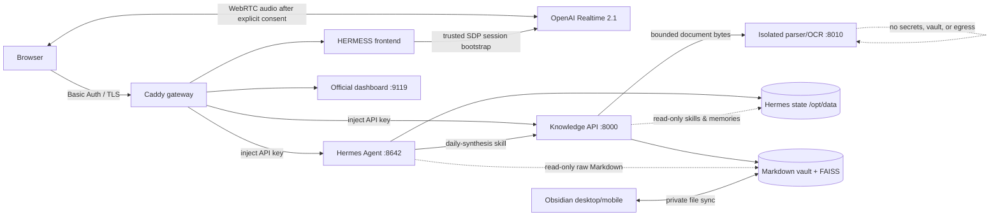

# HERMESS

Your private, always-on second brain: the official Hermes Agent runtime, a
fully local semantic knowledge layer, and a focused command-center UI.

Hermes remains authoritative for agent state, memories, skills, sessions, and
cron. HERMESS adds an Obsidian-compatible note vault, local vector search,
spreading activation, and a UI that makes those systems legible.

## Architecture



- **Hermes core:** one pinned `nousresearch/hermes-agent` instance. Its normal
  image entrypoint supervises the gateway, OpenAI-compatible API, official web
  dashboard, cron, memory, sessions, and skills.
- **Knowledge sidecar:** FastAPI, Markdown, sentence-transformers, and FAISS.
  The model is baked into the image; search has no runtime cloud dependency.
- **Document extractor:** a separate parser-only Python image with local
  Persian/English OCR. It has no model weights, vault/state mount, service
  credentials, or network egress and accepts one bounded job at a time.
- **Frontend:** Next.js 15 + React 19 + Tailwind 4, packaged as a minimal
  standalone Node.js image. Chat uses
  Hermes' streaming OpenAI-compatible API; graph and library use the local API.
- **Solari:** one coherent creative persona over Hermes and the knowledge
  layer, with a 96-role advisory guild, bounded delegation, a Pinterest-style
  signal feed, and an opt-in browser WebRTC voice channel. The browser never
  receives the long-lived Realtime API key.
- **Gateway:** Caddy is the only published service. It authenticates the user,
  removes browser credentials, and injects independent internal service keys.

The official dashboard is intentionally **not** duplicated as another
container. Hermes' current image supervises it alongside the gateway, so a
second dashboard writer would be unsafe.

## Repository layout

```text
.
├── docker-compose.yml              # full single-server stack
├── .env.example                    # secret and provider template
├── Caddyfile                       # authenticated edge + API routing
├── app/ components/ lib/           # command-center frontend
├── knowledge/                      # local index, graph, API, tests, samples
├── config/hermes/
│   ├── profiles/                   # Codex, OpenRouter, Anthropic, local vLLM
│   └── skills/                     # managed vault + synthesis workflows
├── config/hermes-managed/          # immutable runtime safety leaves
├── data/                           # generated persistent state (ignored)
├── scripts/                        # first boot and cron helpers
├── deploy/frontend.Dockerfile
└── deploy/helm/hermess/            # Kubernetes chart
```

## One-command local start

Prerequisites: Docker with Compose and OpenSSL.

```bash
./scripts/quickstart.sh
```

On first boot the script creates `.env`, generates independent service keys,
hashes a strong gateway password, starts the stack, and prints the login once.
It never replaces an existing `.env`.

Open:

- HERMESS: <http://localhost>
- Official Hermes dashboard: <http://dashboard.localhost>

The containers may take several minutes on the first build while the local
embedding model is downloaded into the knowledge image. Subsequent starts are:

```bash
docker compose up --build -d
```

Useful checks:

```bash
docker compose ps
docker compose logs -f hermes knowledge extractor frontend caddy
```

To reuse an existing Hermes installation, stop its current gateway first and
set `HERMES_DATA_DIR` in `.env` to the absolute path of that `~/.hermes`
directory. Never run two Hermes gateways against the same state directory.

## Point Hermes at Codex

The default profile is already configured for:

```yaml
model:
  provider: openai-codex
  default: gpt-5.6-sol
  openai_runtime: auto
```

Complete the one-time OAuth login inside the stateful container:

```bash
docker compose exec --user hermes hermes hermes auth add openai-codex
```

`openai_runtime: auto` keeps Hermes' own tool loop, memory, delegation, session
search, and cron. It does not require a separately installed Codex CLI. The
frontend sends both `provider` and `model`, so changing the active UI profile
changes routing for the next task.

Fallback templates are in `config/hermes/profiles/`:

- `solari` — GPT-5.6 Sol, Hermes Ultra posture, Solari identity and orchestration
- `codex` — primary deep coding and tool work
- `openrouter` — general provider fallback
- `anthropic` — direct Anthropic profile
- `local-vllm` — OpenAI-compatible local endpoint

Set the relevant keys in `.env`. Bootstrap files seed profile configuration
only when missing. Later CLI or dashboard profile edits stay authoritative. The
repository-owned knowledge and creative-work skills are intentionally upgraded
whenever the stack bootstrap/init step runs and are installed into the root and
every persisted named profile.

## Meet Solari

The default HERMESS surface is Solari: a neon, voice-first creative interface
over the same authoritative notes, graph, sessions, and automations. Text work
runs through the `solari` Hermes profile with `gpt-5.6-sol`. Hermes' `ultra`
posture maps to the model's supported maximum reasoning effort; it is a profile
posture, not a claim that 96 processes run at once.

`solari-orchestrator` provides 96 named specialist roles across eight guilds.
They are a searchable responsibility registry. For complex work Solari selects
the smallest useful crew—normally no more than four concurrent workers—and
reports only delegations that actually ran. Handoffs cannot widen authority or
turn a draft into a mutation.

Realtime voice uses the official unified WebRTC flow. It is disabled and
fail-closed until a dedicated OpenAI API key with Realtime access is mounted.
Codex OAuth authenticates Hermes text work but is not an OpenAI API key. For
Compose, set the dedicated key in the private `.env`; Compose materializes it
as a read-only secret file for the frontend server:

```dotenv
SOLARI_REALTIME_ENABLED=true
OPENAI_REALTIME_API_KEY=sk-project-key-from-a-dedicated-realtime-project
SOLARI_REALTIME_MODEL=gpt-realtime-2.1
```

The deployment mounts that file only into the frontend server process. Never
use a `NEXT_PUBLIC_*` variable, browser storage, or a Docker build argument for
this key. Solari checks readiness before requesting microphone permission;
Start, Mute, interrupt, and End remain explicit, and ending or any transport
failure stops every local media track. Voice can search bounded knowledge
excerpts through a single read-only tool; it cannot write notes or choose URLs.
This UI does not retain raw audio.

## Add notes and discover connections

Drop Markdown anywhere below `data/knowledge/notes/`. Wiki links and frontmatter
are optional, but this shape works well in Obsidian:

```markdown
---
title: Retrieval should explain itself
tags: [memory, retrieval]
permanent: false
---

Semantic similarity is useful, but the UI should show why two notes activated.
Connect this to [[Agent memory should decay with grace]].
```

The watcher indexes changes automatically. You can also click **Re-index
knowledge** in the footer. Open **Knowledge graph** and click **Discover links**
to run local connection discovery; **Memory & skills** supports editing and
permanent-note promotion.

The sidecar imports the root and every named profile's `skills/**/*.md`,
`MEMORY.md`, `USER.md`, and `memories/**/*.md` as read-only reference records. The
personal graph excludes those system references and bundled starter notes by
default, so every visible graph node belongs to the operator's vault. It
never scans `SOUL.md`, configuration, `auth.json`, session databases, or other
credential-bearing state. Full API details are in
[`knowledge/README.md`](knowledge/README.md).

## Use the vault with Obsidian

The authoritative vault directory is `data/knowledge/notes/` in Compose (the
knowledge PVC's `notes/` directory in Kubernetes). Keep its Obsidian vault name
equal to `OBSIDIAN_VAULT_NAME`—`HERMESS` by default—so **Open in Obsidian** links
resolve on desktop and mobile without exposing the server path.

For a headless server, use a private, conflict-aware file sync such as Syncthing
over a VPN to mirror that directory to an Obsidian client. Obsidian Sync itself
requires an Obsidian client at each endpoint; use it only when such a client is
actually running against the server-side vault. Do not expose the directory as
a public writable share. The safe ownership model is:

- Obsidian and the sync layer may edit normal Markdown files.
- Hermes receives `/vault` read-only and never writes files directly.
- Hermes and the HERMESS UI create/edit/promote notes only through the
  knowledge API, using idempotency keys and content revisions.
- The watcher hashes stable file content, ignores `.obsidian`, trash, sync
  metadata and temporary files, and refreshes search/graph after external edits.
- A concurrent Obsidian edit causes an API conflict instead of being silently
  overwritten. Refresh and merge the current Markdown before retrying.

To remove one of your own notes from HERMESS, open it in **Knowledge vault**,
choose **Trash**, and confirm **Move to Trash**. The operation is revision
checked: if Obsidian changed the Markdown after it was opened, HERMESS returns
a conflict and refreshes the note instead of deleting the newer version.
Eligible notes are moved—not permanently erased—to the hidden,
scanner-excluded `.trash/hermess/` area and disappear from the active search
and personal graph after reindexing. Read-only Hermes sources and
system-managed starter files never expose this control. Imported originals
remain recoverable in private state storage. Back up the Markdown vault
independently of the rebuildable FAISS state.

### Import files from the panel

Open **Knowledge vault** and choose **Import files**. The panel uploads directly
to this HERMESS installation, shows real byte progress, and reports a confirmed
result for every file. Extraction is local and deterministic; sanitized content
is committed as Obsidian-compatible Markdown under `inbox/imports/` (or as a
permanent note only when explicitly selected), then indexed after the durable
commit.

The live capability response is authoritative for formats and limits. The base
pipeline accepts Markdown/text, CSV, JSON, sanitized HTML, PDF, DOCX, PPTX,
XLSX, PNG, JPEG, WebP, TIFF, and BMP. Images and scanned PDF pages use local
Persian/English OCR. It rejects legacy/macro Office files, archives, encrypted
documents, executables, SVG, and URL imports. Raw source bytes are retained privately by
SHA-256 under the knowledge state directory—not inside the Obsidian vault or a
public route—and the derived note records filename, MIME type, size, hash,
extractor, and version. Re-importing identical bytes is idempotent; same-named
files with different bytes become distinct hash-derived notes. Inbox is the
default so extracted text can be reviewed before promotion.

This release does not claim antivirus scanning, so import only authorized,
trusted files. The parser/OCR runtime is a dedicated egress-disabled,
resource-limited image; high-volume intake can add Docling and a ClamAV
INSTREAM scanner before this same atomic commit boundary. Raw upload and extraction stay on this server; indexed
excerpts can later be sent to a configured AI only when the user explicitly
invokes Solari or brain search.

## Grow and remix ideas

HERMESS ships six managed Hermes skills in the root home and every persisted
named profile:

- `obsidian-knowledge` reads the shared vault safely and writes only through the
  revision-checked knowledge API.
- `daily-synthesis` creates one bounded, evidence-labelled incubation note.
- `idea-gardener` develops a raw fragment into possibilities, tensions,
  experiments, and open questions without erasing the original thought.
- `concept-remixer` finds distant but defensible bridges and labels semantic
  suggestions separately from facts.
- `inspiration-board` curates a living, path-linked Obsidian board with anchors,
  sparks, tensions, negative space, and a suggested traversal path.
- `solari-orchestrator` selects and coordinates the smallest useful crew from
  Solari's 96-role registry with bounded, evidence-preserving handoffs.

The three creative skills are read-only unless the user explicitly asks to save
their result. Durable writes use stable idempotency keys and the same conflict
rules as the UI; they never mutate the raw `/vault` mount.

## Schedule nightly incubation

After Codex authentication, install the included Hermes-native synthesis job:

```bash
./scripts/install-nightly-job.sh
```

Its default schedule is `0 2 * * *`. Override it with the first argument:

```bash
./scripts/install-nightly-job.sh "30 1 * * *"
```

The job is pinned to `openai-codex / gpt-5.6-sol`, loads the
`daily-synthesis` skill, reads the knowledge API, explains at most five novel
connections, and creates a dated Markdown synthesis without changing sources.

```bash
docker compose exec --user hermes hermes hermes cron list
docker compose exec --user hermes hermes hermes cron run nightly-incubation
docker compose exec --user hermes hermes hermes cron pause nightly-incubation
docker compose exec --user hermes hermes hermes cron resume nightly-incubation
```

Hermes cron ticks every 60 seconds, so a manual run is claimed on the next tick.
The Automations surface uses Hermes' authoritative jobs and run history; edits,
triggers, and deletes are revision-checked to reject stale browser state.

## Frontend surfaces

- **Solari:** generated persona portrait, opt-in full-duplex voice, truthful
  live status, 96-role manifest, and a bounded infinite signal feed
- **Today:** a Pinterest-inspired living Brainboard built from real notes,
  memories, insights, tasks, skills, graph bridges, sessions, and automations
- **Chat:** streaming responses, visible tool-call cards, stop control, profiles
- **Knowledge graph:** D3 force graph, filters, zoom/drag/focus, node inspector
- **Memory & skills:** local search, editable vault Markdown, backlinks, promotion
- **Sessions:** FTS/source filters, transcript/tool traces, export and safe prune
- **Automations:** create/edit/delete, pause/resume, run-now, and run history
- **Tasks:** lightweight four-stage agent board
- **Profiles:** active/request routing and provider/model persistence
- **Runtime & logs:** version, gateway/components/platforms, filtered live tail
- **Analytics:** real 7/30/90-day token, cost, session and model breakdowns
- **Capabilities:** installed skills, MCP servers, and read-only Hermes memory
- **Settings:** curated config plus redacted provider credential addition; existing
  credential removal stays in the official dashboard because Hermes identifies
  pool entries by a mutable position rather than a stable conditional ID

When an authoritative dependency is unavailable, its mutation controls fail
closed instead of accepting browser-only changes that would disappear later.

## Kubernetes

The Helm chart preserves the same boundaries and fixes Hermes at one stateful
replica. The knowledge process is a second container in that same Pod, so both
private `ReadWriteOnce` volumes move together during failover. Build and publish
the three project-owned images to a registry your cluster can pull from first.
The two Python targets intentionally have different dependency and trust surfaces:

```bash
docker build -f deploy/frontend.Dockerfile -t registry.example.com/hermess/frontend:0.1.0 .
docker build -f knowledge/Dockerfile --target knowledge -t registry.example.com/hermess/knowledge:0.1.0 knowledge
docker build -f knowledge/Dockerfile --target extractor -t registry.example.com/hermess/extractor:0.1.0 knowledge
docker push registry.example.com/hermess/frontend:0.1.0
docker push registry.example.com/hermess/knowledge:0.1.0
docker push registry.example.com/hermess/extractor:0.1.0
```

Then install the chart with those immutable image tags:

```bash
helm upgrade --install hermess deploy/helm/hermess \
  --namespace hermess --create-namespace \
  --set frontend.image.repository=registry.example.com/hermess/frontend \
  --set frontend.image.tag=0.1.0 \
  --set knowledge.image.repository=registry.example.com/hermess/knowledge \
  --set knowledge.image.tag=0.1.0 \
  --set extractor.image.repository=registry.example.com/hermess/extractor \
  --set extractor.image.tag=0.1.0 \
  --set knowledge.vaultName=HERMESS \
  --set caddy.appAddress=brain.example.com \
  --set caddy.dashboardAddress=dashboard.brain.example.com
```

Create `hermess-secrets` first; the required keys are listed by the chart's
`NOTES.txt` and in `values.yaml`. Use an external secret controller in
production. The chart includes PVCs, health probes, same-Pod read-only Hermes
state access, NetworkPolicies, and the same immutable Hermes digest.

## Security and operations

- Ports 8642, 9119, 8000, 8010, and 3000 are internal-only.
- The Hermes API key can dispatch terminal/file-capable agents; rotate it like
  a remote-execution credential.
- Basic Auth is suitable for a trusted LAN or VPN. Put an OIDC-aware proxy in
  front of Caddy for a public internet deployment.
- `/etc/hermes/config.yaml` uses Hermes' official managed scope to pin unsafe
  startup auto-pruning off for every profile and every supervised hot restart;
  use HERMESS' preview-bound manual prune workflow instead.
- Never mount the Docker socket into Hermes, and never expose the dashboard or
  API container ports directly.
- Keep the Realtime API key server-only. The Solari session bridge accepts only
  same-origin, bounded SDP, uses a stable privacy-preserving safety identifier,
  limits concurrency, and returns raw SDP with `no-store`.
- Browser microphone access is allowed only for the authenticated app origin;
  the dashboard, camera, and geolocation remain denied.
- Back up `data/hermes` and `data/knowledge`. Hermes databases are internal;
  use its API/CLI rather than querying them directly.

The deployment is pinned to Hermes Agent `v2026.8.3`. Review upstream release
notes and re-run the validation suite before changing that tag or digest.

## Development and validation

```bash
npm ci
npm run dev
npm run build
npm run lint
npx tsc --noEmit

python -m venv knowledge/.venv
knowledge/.venv/bin/pip install -r knowledge/requirements-test.txt
knowledge/.venv/bin/pytest -q
knowledge/.venv/bin/ruff check knowledge/app knowledge/tests

docker compose --env-file .env config --quiet
helm lint deploy/helm/hermess
```

Official references: [Docker](https://github.com/NousResearch/hermes-agent/blob/v2026.8.3/website/docs/user-guide/docker.md),
[providers](https://github.com/NousResearch/hermes-agent/blob/v2026.8.3/website/docs/integrations/providers.md),
[API server](https://github.com/NousResearch/hermes-agent/blob/v2026.8.3/website/docs/user-guide/features/api-server.md),
[dashboard](https://github.com/NousResearch/hermes-agent/blob/v2026.8.3/website/docs/user-guide/features/web-dashboard.md), and
[cron](https://github.com/NousResearch/hermes-agent/blob/v2026.8.3/website/docs/user-guide/features/cron.md).
